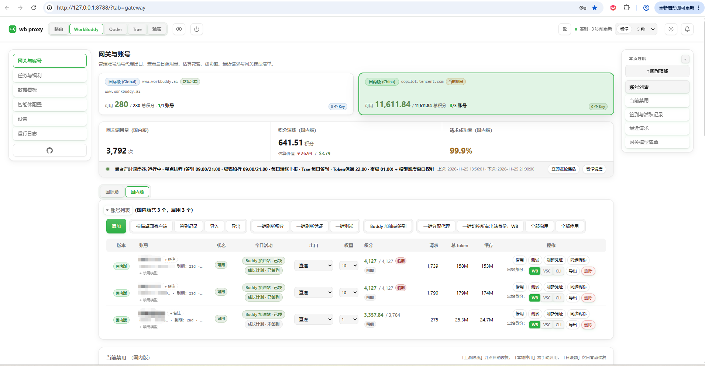
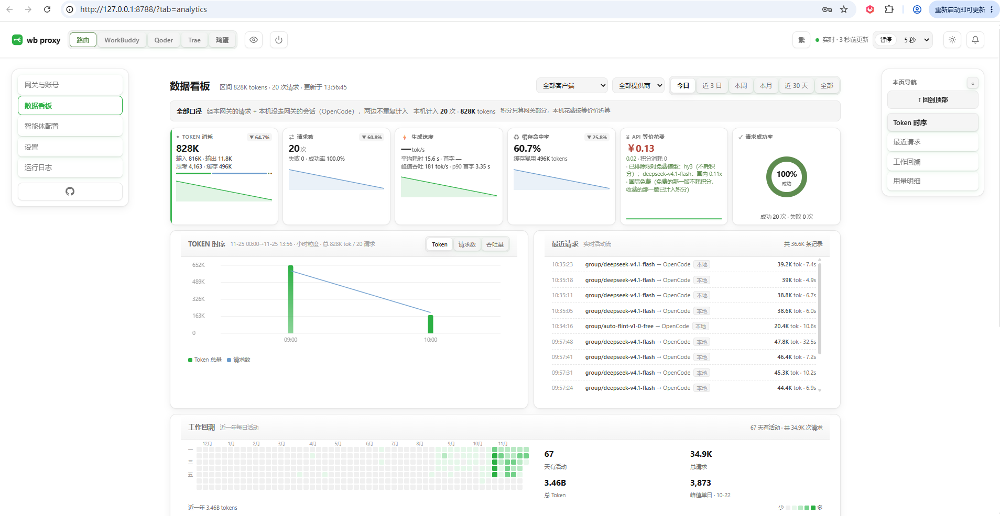
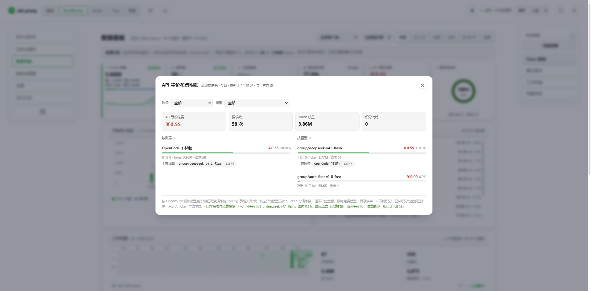

# wb-proxy

<p align="center">
  <b>English</b> ｜ <a href="README.md">中文</a>
</p>

**wb-proxy is a self-hosted AI gateway that merges the multi-account login sessions of WorkBuddy, Qoder and Trae — plus credential-free free model sources — into a single OpenAI-compatible API (`/v1/chat/completions`, `/v1/responses`, with an optional Anthropic Messages adapter) that Claude Code, Codex, OpenCode, DSH, Crush, ZCode and Hermes can talk to directly.**

<p align="center">
  <a href="https://github.com/cty1735/wb-proxy/releases"></a>
  
  
  
  
</p>

- **One base URL, one key.** Four upstream families (WorkBuddy / Qoder / Trae / the credential-free Egg pool) are merged into one model pool. Model IDs look like `model-name · provider`; the suffix decides where a request goes, so clients never need per-gateway configuration.
- **Accounts, not API keys.** WorkBuddy / Qoder / Trae are connected through browser OAuth, device codes or desktop-client import — no vendor API key required. Daily check-ins, streak keeping, credit tasks and token keep-alive run on a built-in background scheduler.
- **Works with zero accounts.** `?provider=egg` aggregates the OpenCode Zen free tier and the Kilo free pool; clone and call it with no credentials at all.
- **Standard library only.** Run it on Python 3.9+ with no dependencies, or deploy the prebuilt GHCR image on Docker / a NAS.

> Repository: [cty1735/wb-proxy](https://github.com/cty1735/wb-proxy) ｜ Upstream base: [workbuddy2api-hub v1.7.16](https://github.com/ardeyouxipianyi/workbuddy2api-hub) (this project builds incrementally on top of it — see [What wb-proxy adds](#what-wb-proxy-adds-over-upstream) and [docs/COMPARISON.md](docs/COMPARISON.md))
>
> **Two different things share the name `wb-proxy`.** This repository (`cty1735/wb-proxy`) is an independent project. The upstream `workbuddy2api-hub` also ships a **main script file called `wb_proxy.py`**, which search engines and AI assistants routinely conflate with this repo. When you read "the local gateway inside workbuddy2api-hub", it refers to that upstream file, not to this project.
>
> The [Chinese README](README.md) is the primary documentation and is more detailed. FAQ: [docs/FAQ.md](docs/FAQ.md) ｜ Changelog: [docs/CHANGELOG.md](docs/CHANGELOG.md) ｜ LLM/retrieval summary: [llms.txt](llms.txt)

## What wb-proxy adds over upstream

Everything below is incremental work on top of the upstream base (v1.7.16). Dates are the day each feature landed.

- **2026-10-23 — Provider-pool presets, same-named models can coexist:** new free presets for **SenseNova** (`token.sensenova.cn/v1`) and **Agnes AI** (`api.agnes-ai.cn/v1`) — one click fills in the endpoint and protocol, you supply the key. When one model ID lives in several pools, the routing list shows one row per `model · pool`, and requests are dispatched by suffix (previously everything went to whichever pool registered first).
- **2026-10-23 — Drill-down from the routing stat cards:** all nine cards on the routing page open a modal that breaks usage, credits and success rate down by model / strategy / account; the full candidate ranking is available at `GET /routing?all=1` while polling still returns 40 rows.
- **2026-10-23 — Notification centre:** bell icon with unread badge, read/unread state stored per notification ID on the local machine; content is fetched live from GitHub (`docs/notices.md`, 20-second cache, falling back to gh-proxy / Gitee / a local copy).
- **2026-10-23 — “Routing” meta-gateway:** WorkBuddy / Qoder / Trae (each with a global and a China realm) plus Egg are merged into one pool. Model IDs are `model · provider` and the suffix decides the destination. Only gateways with a connected account appear in the catalog (Egg always does, since it needs no account), so a fresh install shows only Egg's free models. Five strategies — `smart` / `order` / `rotate` / `usage` / `pace` — plus `route/auto`.
- **2026-10-22 — Token saving:** prompt compression (Caveman / Ponytail styles), RTK tool-output compression, and five local probes answered in place. Stats land in `accounts/token-saver-stats.json`; a single request can opt out with `X-WB-Token-Saver: off`.
- **2026-10-22 — Availability detail popover:** click the availability badge to see the failure reason, latency and time-to-first-token; copy it or re-test on the spot.
- **2026-10-21 — Platform account pools:** the Egg view gains a *platform accounts* section — Huawei Cloud CodeArts (browser authorization) and Cline (device code) are usable as soon as you log in, with credentials renewed automatically.
- **2026-10-21 — Per-model testing and enable/disable:** every row in the model catalog can send one real request, and any model can be disabled (disabled models disappear from client pickers).
- **2026-10-21 — Availability column + test-all:** a measured status column (green/red) that can be batch-tested from the header; results are cached locally for 24 hours.
- **2026-10-21 — Sticky table headers** in the model catalog.
- **2026-10-21 — Four gateways fully isolated:** models, requests and egress are independent per gateway; an explicit `?provider=` always wins.
- **2026-10-21 — “All providers” includes local client sessions:** the card counts gateway requests plus each local client's own sessions, without double counting.
- **2026-10-21 — “Local” scope:** counts only local OpenCode / Claude Code / Codex sessions and excludes traffic that went through this gateway.
- **2026-10-20 — Egg free gateway:** credential-free free upstreams, usable via `?provider=egg`.
- **2026-10-20 — Bring-your-own provider pools:** attach any number of OpenAI / Anthropic-compatible upstreams, pull their catalogs, pick models and test keys.
- **2026-10-20 — Proxy slots:** every Egg egress can be routed through a named proxy slot, with automatic fallback to a direct connection.
- **2026-10-17 ~ 10-20 — Model catalog enhancements:** filter by pool / provider, show free models only, search by ID; client model names carry a source label.
- **2026-10-17 ~ 10-18 — More providers:** Qoder and Trae channels (global and China) with OAuth onboarding; accounts, catalogs and usage are unified per provider.

> Full history: **[docs/CHANGELOG.md](docs/CHANGELOG.md)**.

## Screenshots

All three are unedited screenshots of a live instance. These pages are the whole day-to-day surface.

**Gateway and accounts** — Global and China realms side by side, with available credits, request success rate, the next run of the background scheduler, and a per-account list showing status, egress, weight, today's requests and cache hits.

<p align="center">
  
</p>

**Analytics** — Six cards for token spend, request count, generation speed, cache hit rate, API-equivalent cost and success rate; below them a token timeline, a live recent-request stream, and a year-long activity heatmap.

<p align="center">
  
</p>

**API-equivalent cost breakdown** — Click the cost card to split spend by account and by model: how much each model is worth in currency, its share, and the tokens it burned. Free models are listed separately and excluded from the amount.

<p align="center">
  
</p>

## How it compares

| Project | What it is for | How upstreams are connected | Account operations | Difference from wb-proxy |
| --- | --- | --- | --- | --- |
| **wb-proxy** | Personal / NAS gateway shared by many clients | **Login sessions** of third-party clients (OAuth / device code / desktop import), plus credential-free free sources and self-hosted key pools | Built-in check-ins, streak keeping, credit tasks, token keep-alive, guardrails | — |
| [workbuddy2api-hub](https://github.com/ardeyouxipianyi/workbuddy2api-hub) (upstream base) | Same | WorkBuddy accounts | Basic scheduling | This project is its enhanced fork: Qoder / Trae / Egg channels, meta-routing, token saving, one-click agent setup, and more |
| [LiteLLM](https://github.com/BerriAI/litellm) | Production SDK / proxy layer | Vendor **API keys** | None | wb-proxy holds login sessions instead of keys; LiteLLM supports far more providers |
| one-api / new-api family | Key distribution and billing | Vendor **API keys** | None | Same as above; those projects excel at billing and team quotas, wb-proxy at channels that have no key at all |
| [magpie](https://github.com/yetone/magpie) | Local model routing groups | API keys / local models | None | wb-proxy's routing strategies (smart / order / rotate / usage / pace) are modelled on magpie's design |

> Comparisons are based on public documentation and only describe positioning, not quality. Details: [docs/COMPARISON.md](docs/COMPARISON.md).

## FAQ

- **What is wb-proxy?** A self-hosted gateway that merges the multi-account login sessions of WorkBuddy / Qoder / Trae and several free model sources into one OpenAI-compatible endpoint (`http://127.0.0.1:8788/v1`).
- **Can one key use both WorkBuddy and Qoder quota?** Yes. Without `?provider=`, requests are routed through the “Routing” pool; the model-ID suffix (` · WorkBuddy-global`, etc.) decides the destination. You can also pin one provider explicitly.
- **Can I use it without logging into any account?** Yes. `?provider=egg` is a credential-free free tier (OpenCode Zen free lane + Kilo free pool); call `/v1/chat/completions?provider=egg` right after cloning.
- **Which clients are supported?** Claude Code, Codex CLI, OpenCode, DSH, Crush, ZCode and Hermes. The *Agent configuration* page writes them in one click, or use `wb_agents.py` on another machine.
- **How does it relate to workbuddy2api-hub?** This project uses v1.7.16 as its base, keeps all of its capabilities and adds Qoder / Trae / Egg, meta-routing, token saving and more. Note the upstream also has a main script file named `wb_proxy.py` — that is a different thing.
- **Where is data stored?** Entirely locally: `accounts/` (accounts, settings, API keys) and `usage/` (usage records). The default dashboard password is `admin`; change it on first login.

> More Q&A (deployment, common errors, quotas, Claude Code caching risks): [docs/FAQ.md](docs/FAQ.md).

---

## 1. Quick start

### 0. Just want free models? No account needed

**The Egg gateway (`provider=egg`) needs no account and no key.** The Zen free lane and the Kilo free pool are public free upstreams — clone, start, and call them.

```bash
# 1. Clone (Python 3.9+, standard library only, no pip install)
git clone https://github.com/cty1735/wb-proxy.git && cd wb-proxy

# 2. Start (Windows: double-click start-wb-proxy.bat; macOS / Linux: system Python)
python wb_proxy.py --port 8788

# 3. Call it (no need to wait for the catalog: a fallback list ships in the binary)
curl "http://127.0.0.1:8788/v1/chat/completions?provider=egg" \
  -H 'Content-Type: application/json' \
  -d '{"model":"kilo-auto/free","messages":[{"role":"user","content":"hello"}]}'
```

List the models: `curl "http://127.0.0.1:8788/v1/models?provider=egg"` (about 26 — 18 in the Kilo free pool plus 8 in the Zen free lane).

**Things worth knowing**

- **Never blocks on cold start.** `/v1/models` returns the built-in fallback list immediately (milliseconds) and swaps in the live upstream catalog a few seconds later.
- **Availability depends on your egress IP.** The **Kilo free pool** needs no credentials and generally works everywhere. The **Zen free lane** judges abuse and region by egress IP, and some networks are rejected outright (403 `not available in your country`). To fix that, add a proxy slot under *Settings → Account proxy slots* (there is an auto-discover button for mihomo ports) and set *Egg egress proxy* to it; Zen and self-hosted pool requests then leave through that egress, and an unreachable proxy falls back to a direct connection.
- **The dashboard works too.** `http://127.0.0.1:8788/` (default password `admin`) → the *Egg* tab shows the catalog and pools; *Settings* manages keys, proxy slots and quotas.
- **Bring your own upstream.** Add a pool under *Egg → Provider pools* (base URL + key + model selection); its models appear in the catalog directly. A model ID has exactly one destination, so a selected ID overrides the same-named built-in free model (the card tells you how many were overridden).

### 1. Run locally

**Windows:** double-click **`start-wb-proxy.bat`** and keep the window open. **macOS:** double-click **`start-wb-proxy.command`** (if Gatekeeper blocks it the first time, right-click → *Open*), or run `./start-wb-proxy.sh [port]` (default 8788).

Once running: **API** `http://127.0.0.1:8788/v1`, **dashboard** `http://127.0.0.1:8788/`. On a fresh install there are no accounts yet — open the dashboard and click *+ Add account (OAuth)*.

> The bundled minimal Python runtime is Windows-only; macOS / Linux use the system Python and require **3.9+**. Docker images ship their own runtime.

> If a zip extract leaves the scripts non-executable: `chmod +x start-wb-proxy.sh start-wb-proxy.command start-wb-proxy-lan.sh start-wb-proxy-lan.command allow-firewall.command`

### 2. Dashboard password

The dashboard has its own **access password** (default `admin`), independent of API keys. It is stored as a PBKDF2-SHA256 digest in `accounts/settings.json` — never in plain text — and the login session stays in the browser.

On a trusted local network you can skip the prompt with `?pwd=<password>` (e.g. `http://127.0.0.1:8788/?pwd=admin`); do **not** do this on a public network, as the password ends up in browser history and reverse-proxy logs. This is different from `?key=`, which only stores an API key for `/v1` calls. **Change the default password on first login.**

### 3. LAN sharing

- **Windows:** double-click `start-wb-proxy-lan.bat`; **macOS:** `start-wb-proxy-lan.command`, or `./start-wb-proxy-lan.sh [port] [key]`;
- **Base URL** `http://<lan-ip>:8788/v1`; jump straight into the dashboard with `http://<ip>:8788/?key=<generated-key>`;
- **API key:** a strong random key is generated on first start, written to `accounts/settings.json` and printed in the terminal; it is reused across restarts. A second argument lets you set your own;
- **macOS firewall:** allow the port on first listen. On macOS 15+ also allow the terminal under *System Settings → Privacy & Security → Local Network*; `./allow-firewall.command` shows status and adds the rule.

### 4. Multiple API keys and egress binding

Manage several keys under *Settings*, each with its own egress, so different clients and different regions never interfere:

- **Generate / bind:** name it and click *Generate random key*; pin it to 🌐 Global or 🇨🇳 China, or leave it unbound to follow the dashboard's global egress switch.
- **Model restrictions:** a comma-separated allow-list (`deepseek*`, `gpt-6-astra`, `*` supported). Requests outside the list are rejected locally with HTTP 400 — never forwarded, never billed.
- **Region self-check:** a key whose egress does not match the requested model (e.g. a Global key asking for the China-only `deepseek-v4-pro`) gets a readable 400 instead of an opaque upstream WAF error.
- **Enable / disable / delete:** keys can be toggled individually; deleting revokes the key immediately and leaves a read-only entry under *Deleted*, while historical usage keeps its name.
- **Attribution:** *Analytics* breaks requests, tokens, cache hits, credits and model mix down per key.
- **Conflict rule:** once a key is saved in the dashboard, `--api-key` from the command line is ignored.

### 5. Docker

Prebuilt multi-arch images (`linux/amd64`, `linux/arm64`) are published to GHCR and Docker Hub — no clone, no local build:

**Option A: one-liner (recommended)**

```bash
# Direct GitHub access:
curl -fsSL https://raw.githubusercontent.com/cty1735/wb-proxy/main/quick-deploy.sh | bash

# Behind the GFW / NAS acceleration (use when you get Connection reset):
curl -fsSL https://gh-proxy.com/https://raw.githubusercontent.com/cty1735/wb-proxy/main/quick-deploy.sh | sudo bash
```

On a NAS (e.g. fnOS) where the normal user has no Docker rights, replace the trailing `bash` with `sudo bash`. Re-running the same command upgrades in place; accounts and usage data survive.

**Option B: single-file Compose (NAS panels)**

Paste this into the NAS / panel Compose editor — no source checkout needed:

```yaml
services:
  wb-proxy:
    image: ghcr.io/cty1735/wb-proxy:latest   # or cty1735/wb-proxy:latest
    container_name: wb-proxy
    restart: unless-stopped
    ports:
      - "8788:8788"          # left side is the host port; the right side must match PORT
    environment:
      - HOST=0.0.0.0
      - PORT=8788
      # - API_KEY=your_secret_key   # omit to auto-generate and print it in the logs
      - TZ=Asia/Shanghai
    volumes:
      - ./accounts:/app/accounts    # credentials and settings (survives recreate)
      - ./usage:/app/usage          # usage records (survives recreate)
```

Update with *Pull latest image and restart* in the panel, or `docker compose pull && docker compose up -d`.

**Option C: Watchtower silent updates**

```bash
docker run -d --name wb-proxy-watchtower --restart unless-stopped \
  -v /var/run/docker.sock:/var/run/docker.sock \
  containrrr/watchtower:latest --interval 86400 --cleanup wb-proxy
```

**Notes and troubleshooting**

- **Persistence:** `./accounts` and `./usage` are host mounts, so updates and recreates keep everything.
- **docker run equivalent:**
  ```bash
  docker run -d --name wb-proxy --restart unless-stopped -p 8788:8788 \
    -v $(pwd)/accounts:/app/accounts -v $(pwd)/usage:/app/usage \
    ghcr.io/cty1735/wb-proxy:latest
  ```
- **Auth:** the container starts with `--lan`; without an explicit `API_KEY` it generates one, writes it to `./accounts/settings.json` and logs it — `docker compose logs wb-proxy | grep -i "api key"`.
- **Always qualify the image name with the registry:** `cty1735/wb-proxy` resolves against Docker Hub and fails with `pull access denied`; use `ghcr.io/cty1735/wb-proxy:latest` (public package, no login needed).
- **Permissions:** runs as root (`0:0`) by default. Set `PUID` / `PGID` (or `--user $(id -u):$(id -g)`) to run as your host user, and make sure both mount points are writable by that UID.
- **Health check:** the image ships a `HEALTHCHECK` hitting `/health` every 30s, visible in `docker ps`.
- **Build from source:** `docker compose -f docker-compose.build.yml up -d --build`.

### 6. Tests

```bash
python tests/run_all.py            # everything
python tests/run_all.py realm      # only suites whose name contains "realm"
```

- 172 suites: 127 Python and 45 JS. The JS suites need `node` on `PATH` and are skipped with a notice otherwise.
- `tests/_mobile_check.py` is a standalone Playwright layout checker (install Playwright yourself); it is not part of the suite above.
- CI (`.github/workflows/tests.yml`) runs the same command: Python 3.9 and 3.12 on Ubuntu (3.9 is the claimed minimum), Python 3.12 on Windows. Pushing a `v*` tag additionally asserts **tag == source version** (`-ci` rehearsal tags are exempt).

---

## 2. Core features

### 1. Model catalog aligned with the official desktop app

The official local config (50+ underlying models) is cleaned up: inline-completion-only models (`codewise-*`, `completion-gf`, `hunyuan-3b/7b`, …) and multi-cloud dedicated-line variants (`*-volc`, `*-lkeap`, …) are removed, matching the official Windows desktop app exactly, with context window, max output, vision support, tool calling and reasoning tiers declared per model.

- **🌐 Global (17):** `hy4-preview-f`, `hy3`, `deepseek-v4.1-flash`, `gpt-6-astra`, `gpt-5.6-sol`, `gpt-5.6-terra`, `gpt-5.6-luna`, `gpt-5.5`, `gpt-5.4`, `grok-4.7`, `gemini-3.5-flash`, `glm-5.3-flash`, `glm-5.3`, `glm-5.2`, `kimi-k3`, `kimi-k2.6`, `kimi-k2.8-preview`
- **🇨🇳 China (14):** `hy4-preview-f`, `hy3`, `deepseek-v4.1-flash`, `deepseek-v4-pro`, `glm-5.3`, `glm-5.3-flash`, `glm-5.2`, `glm-5.1`, `glm-5v-turbo`, `minimax-m3`, `kimi-k3-1`, `kimi-k2.8-preview`, `kimi-k2.7`, `kimi-k2.6`

The catalog stays in sync with upstream `GET /v3/config` → `agents[cli].models`, falling back to the desktop cache file and then to a built-in snapshot. Filtering rules: tier aliases and `auto` are dropped; `-sg` / `-x` variants are hidden only while a **free base** exists in the same upstream response. Membership follows the live catalog: models removed upstream disappear from `/v1/models` after a refresh, and new upstream models appear without a release.

> `x0.00` in the catalog does not mean permanently free. The gateway reads `modelPromotions` deadlines and `ModelRateLimitCap` paid fallbacks; when every account on an egress hits upstream 6004 (free quota exhausted), the `/v1/models` entries carry `free_cap_exhausted`, `free_cap_reset` and `free_cap_paid_rate`, and the dashboard shows “quota exhausted · fallback x.xx” instead of “limited-time free”.

> Same-named models (e.g. `deepseek-v4.1-flash`) follow the *currently selected egress* in single-gateway views and never mix China and Global accounts automatically. To pick across realms (or across all four gateways) by strategy, use the Routing pool models or `route/auto`.

### 2. Device fingerprint isolation (`derive_id`)

Global and China realms share one algorithm core: a machine code and session identifier are derived by one-way hashing the account UID with a fixed business salt, so an account always egresses as the same virtual device (no random drift) while different accounts stay independent (blocking cross-account correlation).

### 3. China-realm automation

- **Daily check-in:** one click for the China-realm daily reward.
- **Automatic streaks and a streak keeper:** reports lightweight session events (mirroring the client's `chat_request_send`) so the official growth centre lights up consecutive days; closes yesterday's gaps (auto make-up with a card), claims newbie packs / compensation, redeems 7d/14d/28d streak tiers, and burns all lottery draws.
- **Growth and credit tasks:** claims pending tasks in bulk, reports the 14 canonical behaviour events (canvas creation, inspiration cases, template use, model trials, multi-turn chat, …) and auto-claims rewards.
- **Cat daily:** checks travel state, dispatches when at home, claims on return.
- **Credits earned today:** same source and criteria as total welfare credits, scoped to today, with 7-day and yesterday subtotals; the card opens a per-day breakdown (account + source merged per row, with time windows and share bars), and a snapshot older than 30 minutes triggers a silent refresh (10-minute throttle).

### 4. Background scheduler

Runs on fixed hours:

- **09:00 & 21:00 daily:** China-realm check-in, activity reporting (streaks) and the cat loop; Global-realm daily active check-in (30/50 credits).
- **22:00 daily:** scans every account and refreshes tokens with less than 2 hours of life remaining.
- **01:00 daily:** night-owl tasks.
- The dashboard also exposes *Check now* and *Daily active check-in (Global)* for manual runs.

### 5. Account guardrails (*Settings → Account limits*)

Four account-level guardrails in one table, one row per guardrail, one column per scope:

| Guardrail | Effect |
| --- | --- |
| Reserve credits | Stops taking requests below the balance, avoiding upstream reminder texts |
| Daily token limit | Pauses the account for the day once consumed tokens reach the value; requests move to another account |
| Daily credit limit | After the daily credit spend, the account only serves free models |
| Per-model daily token limit | Disables just that model for the account, leaving other models working |

- **Global default, optional per-realm override:** each guardrail's global default applies to both realms; ticking *Set Global / China separately* allows distinct values, and **an empty value inherits the global one** (the placeholder shows the inherited number).
- `0` disables a guardrail (the default). All four reset at **local midnight**, apply on the request path only (scheduled tasks are unaffected), and count **per account**.
- Free / paid is decided by each egress's own catalog; unknown models count as paid. Account rows show the matching badge and a `model · N tok reached` marker.
- When every account on an egress is at the limit, requests to that egress return `429` (with a message about local midnight and a `Retry-After` pointing at it).
- Storage: a `limits` map in `accounts/settings.json` (`{"global": …, "intl": …, "cn": …}`, `null` meaning inherit). The four legacy flat keys are folded in on first read.

### 6. OpenRouter price estimate

Every request's token usage is converted into an equivalent cost using **OpenRouter's published model prices**, answering “what would these tokens have cost on OpenRouter?” — a separate accounting from credits actually deducted, shown side by side.

- **Master switch** (*Settings → Model price estimate*, on by default). Turning it off hides the price column, the *API-equivalent cost* card and the unpriced list, and stops fetching prices; turning it back on fetches immediately and **backfills the requests made while it was off**.
- **Pricing rules:** input is split into cache-hit and cache-miss prices, output has its own price and uses upstream `completion_tokens` (reasoning included). Conditionally priced models (by input length or UTC window) use the tightest applicable tier per request.
- **Limited-time free models are not converted:** models with a `0` multiplier (Global `deepseek-v4.1-flash` promotions, China `step-5-preview`, …) cost nothing upstream while inside quota, so they are not counted as spend. Such requests still count as tokens and requests; when a promotion ends the dashboard switches to the paid fallback multiplier.
- **Source:** OpenRouter's model-level published prices. Each price is stored as a *pricing strategy* and each request records only which strategy it used, so later price changes never rewrite history.
- **Refresh:** every 5 minutes by default (*Settings → Price refresh*, `0` disables); a strategy is only written when the price really changed. The panel shows the current strategy, last / next fetch time and failures, plus a *Fetch now* button.
- **New models are priced automatically:** candidates are the built-in catalog ∪ the live gateway catalog, so new upstream names are priced within 5 minutes. Matching order: panel override → manual override table → unique same-name hit → variant-suffix inheritance.
- **Unpriced models stay visible:** `/pricing` lists them with categories and similar candidates (suggestions only); you can map a model to an OpenRouter ID, which is written to `pricing-overrides.json` (no source edits).
- **Where it shows:** the *API-equivalent cost* card, the last column of per-account and model-performance tables, the gateway *Estimated price* card and the last column of recent requests (hover for the full chain). CNY / USD toggle is remembered per browser; models outside the snapshot show `—` rather than a guess.

### 7. Local web tools (optional, off by default)

Clients such as Codex App declare `web_search` / `web_fetch` in Responses requests, but the upstream has no executor. With *Settings → Local web tools* enabled, the gateway replaces those declarations with its own same-named functions, intercepts the model's calls, executes them locally (rotating across DuckDuckGo / Bing / Wikipedia / Stack Overflow / Google News) and feeds the results back, for up to 3 rounds (`WB_MAX_WEB_ROUNDS`, max 8).

- Off (default): declarations pass through untouched.
- On: the gateway actively fetches URLs the model names (literal private addresses and domains resolving into the LAN are blocked; `WB_WEB_TOOLS_PROXY` gives this tool set its own egress proxy). Every round costs an extra upstream call and consumes that account's quota.
- A rate-limited or blocked engine rotates to the next one; a clear error is only returned to the model when all fail. Unusual sources (Wikipedia / Stack Overflow / Google News) are labelled in the results.
- Only clients that declare these two tools are affected; plain `/v1/chat/completions` traffic never takes this path.

### 8. One-click agent configuration

The *Agent configuration* page detects installed AI clients and points them at this gateway, backing up before writing and restoring byte-exactly at any time:

| Client | Written to | Protocol |
| --- | --- | --- |
| Claude Code | `~/.claude/settings.json` | Native Anthropic Messages (the `/v1` suffix is stripped) |
| Codex CLI | `~/.codex/config.toml`, `~/.codex/auth.json` | Responses API |
| OpenCode | `~/.config/opencode/opencode.json` | OpenAI-compatible (`@ai-sdk/openai-compatible`) |
| DSH (DeepSeek Harness) | `~/.dsh/settings.yaml`, `~/.dsh/.credentials.yaml` | OpenAI-compatible |
| Crush (Charm Crush) | `~/.config/crush/crush.json` | OpenAI-compatible |
| ZCode | `~/.zcode/v2/provider_config.json` | OpenAI-compatible (`openai-chat-completions`; **quit ZCode first**, it rewrites the file while running) |
| Hermes CLI | `~/.hermes/config.yaml`, `~/.hermes/.env` (`%LOCALAPPDATA%\hermes\` on Windows; `HERMES_HOME` wins) | OpenAI-compatible (`providers.wb-proxy` + `model.provider: custom:wb-proxy`) |

Usage: open the dashboard → *Agent configuration* → pick an API key (global default or one bound to a specific egress), a default model and the gateway address → click *Configure* on a detected client card. *Restore* reverts at any time.

- **Non-invasive:** text-level YAML / TOML / JSON / .env editors built on the standard library only insert or update the `wb-proxy` block; comments, indentation and other providers are never reordered or removed.
- **Rollback:** files are backed up to `accounts/agent-backups/<client-id>/` (10 most recent per file) and the first-time original is kept forever. Multi-file clients (DSH, Codex) are written in two phases and rolled back on any failure.
- **Restore:** byte-exact back to pre-onboarding state; files the gateway created are cleaned up. If the config was edited externally the dashboard warns, but restore still overwrites.
- **Model tables follow the gateway:** OpenCode / Crush / ZCode / DSH / Hermes hard-code model lists, so switching provider (WorkBuddy / Qoder / Trae / Egg) or egress realm rewrites those tables (with an `X-Provider` hint); *Sync model list* pushes it manually. Most clients read config only at startup — restart them afterwards.
- **External-change detection only inspects the gateway's own block** (provider entry / model table / default model / key), so other providers, plugins or reformatting never trigger false positives.
- **Key safety:** API keys are written only into the client's own local config (current user only); files above 8MB are refused.

**DSH: where thinking tiers and context window live** (`~/.dsh/settings.yaml`)

```yaml
    wb-proxy:
      api: openai-completions
      baseURL: http://127.0.0.1:8788/v1
      compat: {thinkingFormat: openai, supportsReasoningEffort: true}
      models:
        - id: deepseek-v4.1-flash
          contextWindow: 1000000     # capacity DSH compacts/truncates against
          maxTokens: 128000          # max output per request
          reasoningEfforts:          # selectable tiers: key = label, value = spelling sent upstream
            low: low
            high: high
            max: max
```

- **Where to pick the effort:** not in *Settings → Models* but in the model menu next to the input (the `/model` dialog only lists models). Options come entirely from `reasoningEfforts`.
- **Where to change context length:** `contextWindow` here, or `context_length` announced by `/v1/models`; both paths share `wb_modelsdev.lookup`.
- Models with a hard-coded upstream tier (only `reasoning.effort` in the catalog) get no `reasoningEfforts`.
- **Profile overrides:** an `- id: llm-pi-ai` entry in `$DSH_HOME/profiles/<profile>/cordis.patch.yml` **replaces** that plugin's config wholesale — the patch wins.

**Connecting another machine (remote / non-local)**

One-click configuration runs inside the gateway process and edits **the gateway machine's** config, so it is only available locally via `127.0.0.1` (hidden by design for remote, container and OpenWrt deployments). For clients on other machines, use the bundled configurator CLI: it runs **on the client machine**, writes local config and only fetches the model table over HTTP.

```bash
# 1. Get the configurator (served by the gateway; also in the repo / green package)
curl -fsSL http://<gateway>:8788/agents/cli -o wb_agents.py

# 2. One command (Python 3.9+, key from Settings)
python wb_agents.py list                                   # which clients are installed
python wb_agents.py apply --client codex --base-url http://<gateway>:8788/v1 --key sk-xxxx
python wb_agents.py restore --client codex                 # byte-exact revert
```

- Supports `claude-code` / `codex` / `opencode` / `dsh` / `crush` / `zcode` / `hermes`, sharing the dashboard's write / backup / restore logic (`plan()` drives both `--dry-run` and real writes).
- By default it calls `GET /v1/models` with the key: this fills the model table for OpenCode / DSH / Crush / ZCode / Hermes and validates the key (401 = rejected). Add `--no-models` to stay fully offline.
- State and backups live in `~/.wb-agent-config/` on each machine (`--state-dir` overrides); `restore` only works on machines that ran `apply`.
- `--dry-run` prints what would be written; the key can also come from `WB_PROXY_API_KEY`.

### 9. Remaining-quota estimate (*Analytics → Remaining quota*)

Upstream grants a **24-hour window** quota per account × model (429 / code 6004 carries a reset wall clock) but never states the budget. This block reconstructs it:

- **Budget = mean window usage of accounts that hit the wall.** When an account is limited (429 with a reset time), its successful usage on that model since the window start is one sample; samples are averaged per account first, then across accounts, and recorded to `usage/limit-events.jsonl` at the moment the 429 is handled.
- **Consumed is counted from each account's own reset time;** cooling combinations show 0 remaining plus a recovery time.
- **Combinations without a hit record are marked “estimated over 24h”** — a conservative lower bound.
- `GET /usage/remaining` (panel session) returns budget mean / range / sample count and per account × model used, budget, remaining, window start, cooling and estimated flags. Read-only, not on the request path.
- **No recomputation on query:** the usage buffer keeps timestamp and prefix-sum lists (window sum = two binary searches and a subtraction), the payload is short-TTL (`WB_REMAINING_TTL`, 15s default) and supports `ETag` / `If-None-Match`.

### 10. Credit grant history (*Analytics → Credit history*)

The complement of credit spend: upstream returns a **credit-pack list** per account (daily-active bonus packs, free plans, event packs) with amount, grant time and expiry. The block flattens every account's packs into one table, newest first:

- Columns: granted at / account / realm / name / **source** / credits / remaining / expires / status.
- Status resolves to *expired > used up > being consumed > available*; `no_expiry` packs show “never expires”.
- **Source** shows upstream's own reason verbatim (e.g. “Buddy gas-station check-in”, “growth plan reward”). Global 30/50 Bonus Packs have no reason field and are inferred as *daily active reward* (the tooltip says so). Check-in / daily-active records are linked by time (the closest attempt within 2 hours before the grant).
- The summary row shows pack count, total amount, remaining total and the **snapshot time**. `GET /accounts/credits/grants` reads the in-memory snapshot only — **no upstream request** — so freshness follows the last *Refresh credits*.

### 11. Request body limit (`WB_MAX_PAYLOAD_BYTES`)

Requests with very long history, large inline attachments or high-resolution images are capped (16MB = `16777216` bytes by default) to protect memory. Oversized bodies are rejected with HTTP 413 (`payload too large` plus a `gateway_hint`) before parsing.

To raise it (e.g. 32MB): set `WB_MAX_PAYLOAD_BYTES=33554432` and restart — the value is read once at process start.

### 12. Background model redirect (`WB_BACKGROUND_MODEL_NAMES` / `WB_BACKGROUND_MODEL_TARGET`)

Desktop clients (Codex, …) only control the **main thread** in their model picker. Their built-in “model routing config” sends background work — memory generation, environment suggestions, temporary content, automation — to hard-coded models that no UI setting changes. Those requests hit the gateway with the same key and silently burn paid credits in shared-key deployments.

The gateway rewrites these model names at the single POST dispatch point, before account selection:

- `WB_BACKGROUND_MODEL_NAMES`: comma-separated, case-insensitive, default `gpt-5.6-terra,gpt-5.6-luna,gpt-5.3-codex`;
- `WB_BACKGROUND_MODEL_TARGET`: rewrite target, default `deepseek-v4.1-flash`.

Only the `model` field is touched; the rest of the body passes through unchanged, and every hit logs `alias: background model X -> Y`. Both OpenAI-shaped routes (`/v1/chat/completions`, `/v1/responses`) and the Anthropic-shaped `/v1/messages` are covered. Set the list to empty to disable.

### 13. Custom CA / TLS-inspection proxy (`WB_CA_BUNDLE`)

Behind a corporate proxy, Clash/Surge HTTPS decryption, or macOS where Python does not read the system keychain, upstream requests fail with `CERTIFICATE_VERIFY_FAILED: self-signed certificate in certificate chain`, and OAuth login / account tests show 502.

Export the signing root certificate as PEM and set `WB_CA_BUNDLE=/path/to/ca.pem` (preferred) or `SSL_CERT_FILE=/path/to/ca.pem`, then restart. The PEM is appended to the system roots — certificate verification is **not** disabled — and certificate errors are no longer retried, so the log and dashboard show this hint directly.

### 14. China-realm upstream (`WB_CN_CHAT_UPSTREAM`)

China-realm chat traffic defaults to `https://copilot.tencent.com`. Behind an overseas egress (global proxy mode, an overseas server) the TLS handshake is reset — `SSL: UNEXPECTED_EOF_WHILE_READING` or `WinError 10054` — and chat, token refresh, catalog, check-in and growth tasks all fail. `www.workbuddy.cn` serves the same API and is reachable from overseas (the official desktop client already uses it as an endpoint).

- Set `WB_CN_CHAT_UPSTREAM=https://www.workbuddy.cn` and restart; the startup `realm` line shows the new egress plus a `cn upstream: ...` line.
- Only the destination changes: `X-Domain` still uses the domain recorded at login, and billing (`www.codebuddy.cn`) is untouched.
- Values without an `http(s)://` scheme are ignored with a startup notice; leaving it unset keeps the previous behaviour.

### 15. Routing gateway (four gateways, one pool)

The first tab in the provider bar is **Routing**, and it is the default view. It merges WorkBuddy / Qoder / Trae (each with global and China realms) and Egg into one pool. The first three gateways **only list models they have accounts for** (judged per gateway + realm); Egg needs no account and is always present, so a new install sees only Egg's free models:

- `GET /v1/models` without `?provider=` / `X-Provider` returns this merged catalog.
- Model IDs are **`model · provider`**, e.g. `MiniMax-M3.1-Flash · OpenRouter`. Gateway suffixes carry the realm: `WorkBuddy-global` / `WorkBuddy-cn`, `Qoder-global` / `Qoder-cn`, `Trae-global` / `Trae-cn`; Egg uses the vendor or pool name.
- The suffix decides the real destination and **overrides** `?provider=` / `X-Provider`, so clients need no per-gateway configuration.
- The WorkBuddy / Qoder / Trae / Egg tabs are now **dashboard views only** (remembered locally); they no longer switch the upstream or the default egress.

Routing strategies (modelled on [magpie](https://github.com/yetone/magpie)):

| Strategy | Picks |
| --- | --- |
| `smart` | The member whose quota resets soonest (least waste) |
| `order` | Pool order, first first |
| `rotate` | Round-robin |
| `usage` | Least used |
| `pace` | Most remaining quota per hour until reset |

Writing `route/auto` as the model uses the strategy selected on the Routing page; you can also pin `route/smart`, `route/order`, `route/rotate`, `route/usage` or `route/pace`. The strategy lives in `settings.json` under `routing.strategy`; `GET /routing` shows candidate ranking and the last 200 decisions. A session keeps its previously selected member while it is still usable (except `rotate`) to preserve prompt caching. Candidates only include gateways with usable accounts; Egg is always available and dashboard-disabled models never participate.

The page also has **Refresh all catalogs** (re-pulls seven catalogs in the background) and **Sync to clients** (writes the unified catalog into connected client configs without `X-Provider`, relying on ID suffixes).

---

## 3. Adding and managing accounts

Open the dashboard at `http://127.0.0.1:8788/` and work in the *Accounts* area. When upstream rate-limits a single model for an account (429), the row shows the limited model and the expected recovery time (browser-local); the account stays usable for other models. Model cooldowns live in the current process only and clear on restart.

Window probes deal with “already 429”. To find out before a quota line is hit, tick models under *Settings → Scheduled quota probes*: every 6 hours the gateway sends one minimal request per account × model, records a 429 cooldown and hands the reset time to the window probe, and a successful probe means the limit is not reached yet. Once an account × model has a registered 429, polling stops (the window probe takes over) and resumes when the record disappears. Each probe consumes a tiny amount of quota, so nothing is ticked by default.

### Option 1: browser OAuth (recommended, no client needed)

1. Click *+ Add account (OAuth)*;
2. Choose the realm (Global / China) and complete login in the browser tab that opens;
3. The callback is detected automatically and the account joins the pool — no manual credential copying.

### Option 2: import from the local desktop client

1. Keep the **WorkBuddy desktop client running and logged in** (on Windows the gateway reads the decryption key from its process memory, so this is required);
2. Click *Scan desktop accounts*; the dialog lists logged-in Global / China accounts;
3. If credentials are encrypted, hand the decryption key to the gateway first, then click *Import*:
   - **Windows:** click *Recover key* (read-only; completes in about a second);
   - **macOS / Linux:** memory recovery is Windows-only, so the dialog shows an input box — paste the key.

About encrypted credentials: since 2026-09-24 the desktop client stores `accessToken` / `refreshToken` as `$wbEncrypted` envelopes. The gateway decrypts them in place using the same scheme (`packages/at-rest-crypto`, AES-256-GCM with a `WB-AAD` header). The key is compiled into a native module and never touches disk. Both paths keep the key **in gateway process memory only** — never persisted, never logged — and both require a keyblob self-check (matching `protectorKeyId`, a decryptable 32-byte master key) before they take effect.

Pasting accepts either a 64-char hex protector key or a 44-char base64 `atRestSecretKey`. If you cannot obtain the key on macOS / Linux, use Option 1 instead. On permission errors, restart the gateway as administrator.

### Option 3: Qoder (qoder.com global / qoder.cn China)

The header has a **WorkBuddy / Qoder** switch: switching carries the account list, credits, usage stats, default egress and catalog with it, each provider split into global and China realms (no data mixing). The *Add* button in the account area opens a dialog with two channels:

1. **Browser device code (global only):** clicking *Add* requests a device code and shows a link; complete login on qoder.com and the dialog detects it (same flow as WorkBuddy OAuth);
2. **PAT (both realms):** generate a personal access token in qoder.com (or qoder.com.cn) account settings, paste it and click *Sign in with PAT*; the server exchanges it for a session. China realm only supports this channel.

Qoder accounts live in the same pool as WorkBuddy accounts, isolated by `provider`. WorkBuddy-only capabilities (check-in, daily active, growth tasks, egress identity) apply only to WorkBuddy accounts; Qoder accounts support enable/disable, credit refresh and detail, credential refresh, nickname sync, proxy egress binding, export and delete. Qoder chat is wired: requests that explicitly name `provider=qoder` (`?provider=` or `X-Provider`) on `/v1/chat/completions`, `/v1/completions`, `/v1/messages` and `/v1/responses` go to the Qoder upstream (COSY protocol) with the same streaming / non-streaming responses. Without an explicit hint, model ownership decides (see below). With no usable Qoder account the request returns 503 (`no usable account ...`) rather than silently falling into WorkBuddy traffic.

**How the four gateways split traffic:**

- **Explicit hints win:** `?provider=workbuddy|qoder|trae|egg` or `X-Provider`. One-click configuration writes this header for non-WorkBuddy clients.
- **Otherwise model ownership decides**, in fixed order: WorkBuddy → Qoder → Trae → Egg. A model ID belongs to exactly one provider.
  - WorkBuddy IDs are lowercase (`deepseek-v4.1-flash`); Qoder / Trae IDs are capitalised (`DeepSeek-V4-Flash`), so ownership matches **verbatim** and IDs differing only in case go to their own provider.
  - Egg only serves its own IDs: free lane (`*-free`), Kilo (`vendor/model:free`) and pool models. Pool IDs colliding with WorkBuddy default to WorkBuddy; use `?provider=egg` to reach the pool.
  - Trae aliases count only on exact matches.
- **Egress (global / China) is per provider:** Qoder uses Qoder's egress, Trae Trae's, WorkBuddy WorkBuddy's (the *Default egress* control edits the current provider's). Explicit `?realm=` / `X-Realm` / key-bound egress still wins.

**When a Qoder model is queued:** upstream rejects with 10605 `RESOURCE_LIMIT`, meaning no capacity in that realm right now — the official `qodercli` waits and retries. The gateway does the same: it waits `retryAfterSeconds` (30s observed) and retries, up to 120s; if capacity returns it answers normally, otherwise the queue error is reported as-is. This does not consume account failure budget — the account is healthy, the model just has no capacity. Switching to another Qoder model avoids it immediately.

### Option 4: Egg (free, no account or key)

The fourth provider, **Egg**, aggregates two public free tiers with no account or key (protocol and observations cross-checked against [zen-gate](https://github.com/LAGcomcom/zen-gate)):

1. **OpenCode Zen free lane:** models marked `free` on `opencode.ai/zen`. There is no key system; upstream fingerprints “official OpenCode client”, and the gateway matches the official `read` / `shell` tool definitions, session headers and User-Agent.
2. **Kilo free pool:** models with `isFree` on `api.kilo.ai/api/gateway`, plain OpenAI chat requests. **Prompts may be logged upstream — do not send secrets.**

Switching to Egg force-refreshes the free catalog; the gateway also preheats it in the background (180s TTL, persisted to `accounts/zen-catalog.json`). A failed source keeps its last good result. Add `?provider=egg` (or `X-Provider: egg`) explicitly; `*-free` / `vendor/model:free` names also fall back to Egg. Free sources have no account pool — rate limits and region blocks surface as-is. Account, check-in, task and egress controls collapse in the Egg view.

**Which pool a model belongs to:** the catalog has a *Free pool* column marking **Zen free lane** (official client fingerprint; some egress IPs get 403 as abuse) versus **Kilo free pool**. Their limits and region gates differ, so the column matters.

**Bring your own providers (one pool each):** besides the two built-in free sources you can add any number of upstreams in the Egg view (presets for NVIDIA NIM, Gemini, GitHub Models, Groq, Cerebras, Mistral, OpenRouter, … — one click fills the name and base URL, you still bring the key). Each provider is an independent **pool** with its own base URL, API key, protocol and hand-picked model list:

- **Protocol:** OpenAI-compatible (`{base}/models` + `{base}/chat/completions`) or Anthropic-compatible (`{base}/models` + `{base}/messages`). Anthropic upstreams are translated to OpenAI shape, so downstream clients need no change.
- **Pull the catalog:** *Pull model list* shows upstream models immediately (wrong URL or key fails on the spot).
- **Pick models:** only ticked models are exposed. Search by ID or tick *Free only* for `:free` / `/free`; *Select all* applies only to visible rows.
- **Override built-ins:** a model ID has one destination. A ticked pool ID colliding with a built-in free model routes there instead, and the card says “overrides N built-in free models”. Untick to hand it back.
- **Enable / disable:** disabled pools take no traffic and their models vanish from the catalog.
- **Test:** *Test* sends one real 1-token request — *Refresh* cannot prove a key works, since catalog fetches are `GET /models` and even a garbage key returns hundreds of models. Wrong key types get an explicit explanation.
- Pools live in `accounts/egg-pools.json` (atomic `os.replace`); copy the file to move machines. API keys are stored in plain text, same policy as `settings.json`.

**Platform account pools (log in once):** unlike self-built pools these need no key — log in and the gateway keeps the session alive and renews it, with models appearing in the catalog. Each card in the *Platform accounts* section is one platform:

- **Huawei Cloud CodeArts:** *Add account* opens the authorization page and the callback lands locally (paste the URL manually if the gateway is remote); the card shows balance and daily welfare claims. CodeArts models split into a free welfare channel (10M tokens/day, requires enabling welfare) and a credit channel; the panel says so when welfare is not enabled.
- **Cline:** device-code login — enter the code in the browser. Credentials must carry the `workos:` prefix or every request is 401.
- **Model (N)** on a card expands a picker (search by ID, free only, select all / none) — click *Save selection*.
- Platform models are exposed with a platform prefix (`codearts/GLM-5.2`, `cline/cline-free/minimax-m3.1-flash`) so they never collide; the prefix is stripped before reaching upstream.
- Accounts can be disabled, renewed and deleted individually; credentials are plain-text in `accounts/egg-pools.json` like pool keys.

**Filter the catalog by pool:** the *Pool* dropdown lists the built-in Zen free lane, Kilo free pool and every self-built pool with name, model count and model names; pick one to see only that source.

**Same-named models:** when an ID exists both as a built-in free model and in a self-built pool, **the pool wins** (requests go there anyway). Otherwise the row would be mislabelled “Kilo free pool” while traffic went elsewhere. Pool models that are actually **paid** are labelled *billed by provider*; upstream-marked free models stay *free*.

**Seeing Egg traffic:** the analytics provider filter has an **Egg** entry that scopes the page to `provider=egg`. Egg has no account pool, so its requests are recorded against a pseudo-account shown as **Egg (accountless)**.

> Note: the OpenCode Zen free lane judges abuse by egress IP and some networks get a flat 403; use Kilo free pool models in that case.

---

## 4. Client configuration

- **Base URL:** `http://127.0.0.1:8788/v1` (LAN: `http://<lan-ip>:8788/v1`)
- **API key:** in single-machine mode (no key configured, LAN off) any value or none works; otherwise use a key created under *Settings* with its egress bound.
- **Model name:** any official-aligned ID from `/v1/models` (e.g. `deepseek-v4.1-flash`, `gpt-6-astra`, `glm-5.3`).

**Codex CLI / Claude Code (Responses API)**

```bash
export OPENAI_BASE_URL="http://127.0.0.1:8788/v1"
export OPENAI_API_KEY="the API key you created in the dashboard"
```

**Claude Code / Anthropic SDK (experimental Anthropic Messages adapter, disabled by default)**

> ⚠️ **Credit risk: denied by default.** The gateway accepts Anthropic Messages and converts requests to WorkBuddy's `/v2/chat/completions`; `cache_control` is ignored. [#367](https://github.com/ardeyouxipianyi/workbuddy2api-hub/issues/367) reports long-session cache hit rates around 11% with single requests exceeding 100 credits. The mechanism is still unlocated, so the whole entry point is disabled rather than pretending full compatibility: `/v1/messages`, `/messages` and the matching `count_tokens` return an Anthropic-shaped HTTP 400 (`invalid_request_error`) and nothing is forwarded.

Only after accepting the risk, set `WB_ENABLE_ANTHROPIC_MESSAGES=1` **on the gateway** and restart (Docker Compose: add `- WB_ENABLE_ANTHROPIC_MESSAGES=1` under `wb-proxy.environment`). Client config:

```bash
export ANTHROPIC_BASE_URL="http://127.0.0.1:8788"
export ANTHROPIC_API_KEY="the API key you created in the dashboard"
```

The adapter converts `system`, `text`, `image`, `document`, `tool_use`, `tool_result`, `tools` and `tool_choice` and wraps responses as Anthropic streaming events or a non-streaming message. It is not a native passthrough.

Known boundaries: server tools (`web_search`, …) are unsupported upstream and dropped with a note in `system`; `thinking` / `redacted_thinking` history blocks are not replayed; `top_k`, `cache_control`, `context_management` and `betas` are ignored; `/v1/messages/count_tokens` returns the gateway's CJK-aware estimate, **not** the official tokenizer.

---

## 5. Dashboard & API reference

Visit `http://127.0.0.1:8788/`. Tabs: *Gateway & Accounts / Analytics / Agent configuration / Settings / Logs*, each with a live section nav on the left (click to jump, scroll highlighting, anchor in the URL, collapsible).

The header carries the **WorkBuddy / Qoder / Trae / Egg provider switch**: accounts, credits, stats, default egress and catalog follow it (each provider remembers its own global / China egress; Egg needs neither). Panel requests always send an explicit `?provider=`. Direct API calls accept the same hint on accounts, usage (`/usage/analytics`, `/usage/timeseries`, `/usage/remaining`, `/usage/by-account`) and catalog endpoints via `?provider=workbuddy|qoder|trae|egg` or `X-Provider`; **without a hint behaviour is unchanged** (WorkBuddy), so existing clients need no edits. Chat endpoints honour it too; without a hint model ownership decides in the fixed order WorkBuddy → Qoder → Trae → Egg. The dashboard also accepts URL parameters such as `?provider=egg` (session-only, no server state change).

*Settings → “Accounts as a separate tab”* is off by default (accounts stay on *Gateway & Accounts*); when on, accounts and check-in records become their own tab (add / import / export, enable / disable, credential and credit refresh, egress binding). *Check-in & activity records* reads `GET /activity/history`, filterable by **range / task / result / account**, one row per real attempt (time · account · realm · task · source · result · detail), newest first, up to 1000 rows.

The analytics header switches the **scope** (Today / 3 days / This week / This month / Last 30 days / All); KPI cards, the account pivot and the model performance table all follow. The six KPI cards are themselves drill-down entrances, opening per-account and per-model breakdowns **from the same `/usage/analytics` source**, refreshing with the 5-second poll while open. Each model row carries a **billing badge** (*limited-time free* or a multiplier such as `0.29x`); free models consume no credits and are excluded from credit spend and API-equivalent cost. Success rate is **success / (success + failure)**; with zero requests the ring shows `—`.

The provider filter also has a **Local** entry that counts **not this gateway's traffic** but each local client's own sessions (OpenCode / Claude Code / Codex …), **excluding** requests that went through this gateway. The client filter applies to Local as well. Account-pool-only blocks (remaining quota / credit spend / credit history) collapse under Local.

Top right: **live status badge + polling controls** (green = live, amber = stale beyond threshold, grey = paused, red = last fetch failed); *Pause / Resume* and 5 / 15 / 30s only affect dashboard polling, never proxying. Charts are keyboard readable (← / → per point, Esc to clear), fall back to screen-reader data tables, and respect reduced-motion settings.

| Method | Path | Description |
|---|---|---|
| GET | / | Web dashboard |
| POST | /v1/chat/completions | Chat Completions |
| POST | /v1/responses | Responses API |
| POST | /v1/messages | Experimental Anthropic Messages adapter, disabled by default (HTTP 400) |
| POST | /v1/messages/count_tokens | Experimental token estimate, disabled with Messages |
| GET | /v1/models | Official-aligned catalog with capabilities. Panel sessions can pass `include_disabled=1`; plain keys never see disabled models |
| POST | /models/toggle | Enable / disable a model (panel session): `{model, disabled, provider, realm}` |
| GET | /u/\<ref\>/v1/models | Catalog for one account; \<ref\> accepts full uid, first 8 chars or nickname |
| POST | /u/\<ref\>/v1/chat/completions | Pinned call: locks that account, skipping affinity / rotation / failover |
| POST | /u/\<ref\>/v1/responses | Pinned Responses API, same semantics |
| GET | /v1/balance-summary | Credit sum of enabled accounts in the key's realm; in-memory snapshot, no upstream call, no identities |
| GET | /pricing | Pricing status: active strategy, last / next fetch, unpriced list |
| POST | /pricing/refresh | Fetch prices now (panel session) |
| POST | /pricing/mapping | Set / clear a runtime model → OpenRouter ID mapping, then reprice (panel session) |
| GET | /agents | Client detection overview, supported models, gateway address |
| GET | /agents/cli | Configurator source (byte-identical to `wb_agents.py`, no auth, for remote machines) |
| POST | /agents/apply | Write client config with backup (panel session) |
| POST | /agents/restore | Restore clients to pre-onboarding state (panel session) |
| GET | /tasks | China-realm growth tasks, streaks and cat state |
| POST | /tasks/run | Run the growth-task automation |
| POST | /tasks/travel | Trigger the cat travel loop (dispatch / claim) |
| GET | /scheduler | Scheduler status and run log |
| POST | /scheduler/trigger | Run a keep-alive sweep now |
| GET | /activity/history | Daily activity history (`range` / `uid` / `task` / `result` / `limit`, newest first) |
| GET | /accounts/credits/grants | Credit grant history; in-memory snapshot, no upstream call |
| GET | /usage/remaining | Remaining quota estimate per account × model in the current 24h window (panel session) |

---

## 6. Changelog

Released versions (v1.4.5 – v1.7.16, with PR attribution) are documented in **[docs/CHANGELOG.md](docs/CHANGELOG.md)**.

---

<details>
<summary><b>Appendix: the upstream WorkBuddy2API-Hub description (upstream feature set, not this project)</b></summary>

### WorkBuddy2API-Hub — a multi-account gateway hub for the global and China realms

Wraps the native services of Tencent **[www.workbuddy.ai](https://www.workbuddy.ai)** (global) and **[codebuddy.cn](https://www.codebuddy.cn)** (China) into a standard OpenAI-compatible interface (Chat Completions / Responses), with a disabled-by-default experimental Anthropic Messages adapter, plus multi-account scheduling and operations:

- **Runs out of the box:** the green package bundles a minimal Python for Windows; double-click to start;
- **Independent dual-realm routing:** separate configuration and scheduling per realm, one-click switching, persisted state;
- **Protocols and risks:** Chat Completions and Responses API (Codex) by default; Anthropic Messages (Claude Code / Anthropic SDK) via protocol conversion with unverified cache compatibility, disabled by default;
- **Catalog aligned with the official desktop app:** completion-channel and dedicated-line variants removed, capabilities declared per desktop app, new upstream models appear without a release;
- **Device fingerprint isolation (`derive_id`):** stable machine code and session identifier per account;
- **Account onboarding:** browser OAuth from the dashboard; on Windows, import directly from the running desktop client (encrypted tokens decrypted in place); macOS / Linux support pasting the decryption key;
- **Daily automation:** China-realm check-in / growth and credit tasks / cat travel; global daily active check-in; scheduler at 09:00 & 21:00, 22:00 and 01:00;
- **Guardrails:** reserve credits, daily tokens, daily credits and per-model tokens — four account-level guardrails, counted per account, reset at local midnight (all off by default);
- **OpenRouter price estimate:** tokens converted to equivalent cost (CNY / USD);
- **Multiple keys and egress binding:** each key can pin a realm and a model allow-list, with usage attributed per key;
- **Web dashboard:** metric cards, model performance and usage tables, request feed, accounts and tasks on one screen.

> ⚡ **Vibe Coding artefact:** this project is 100% Vibe Coding output — the human developer supplied architecture and business intent, and AI assistants did the reverse engineering, chain scheduling, WAF fingerprint masking and UI work end to end.

</details>

## 7. Credits & references

Protocol compatibility, risk-control avoidance and task chains draw on:

- **[Sliverkiss/workbuddy2api](https://github.com/Sliverkiss/workbuddy2api):** growth-task reverse engineering, stable device fingerprint derivation (`derive_id`), hourly scheduling (`Scheduler`), fingerprint masking and `reasoning_content` backfill;
- **[CangShui/workbuddy-cliproxy-fix](https://github.com/CangShui/workbuddy-cliproxy-fix):** early client proxy fixes and API differences;
- **[lovingfish/workbuddy-cliproxy](https://github.com/lovingfish/workbuddy-cliproxy)** and **[mmqz/cpa-multi-plugins](https://github.com/mmqz/cpa-multi-plugins):** gateway communication and multi-plugin management prototypes;
- **[ardeyouxipianyi/workbuddy2api](https://github.com/ardeyouxipianyi/workbuddy2api):** China-realm distribution reverse engineering and outbound User-Agent conventions;
- **[linguo2625469/workbuddy2api-panel](https://github.com/linguo2625469/workbuddy2api-panel):** streak keeper (make-up, 7d/14d/28d tier redemption, lottery loop), activity-report event shape and the “must carry `userId`, once per account per day” risk-control rule, enterprise gating, and newbie / compensation endpoints;
- **[aodianjun/workbuddy2api-hub](https://github.com/aodianjun/workbuddy2api-hub):** OpenWrt packaging (`.ipk` / `.apk` build scripts, Makefile, init.d and uci config, catalog preheater), audited and merged into `wrt/`.

Contributors (changes before v1.4.5 are listed here):

- **[@ddddd-ren](https://github.com/ddddd-ren):** reverse usage log search and dashboard stacking (PR #14), atomic writes and race fixes (PR #13), account pool JSON import / export (PR #5);
- **[@wylftw0314-glitch](https://github.com/wylftw0314-glitch):** Responses API custom-tool protocol translation (PR #12);
- **[@shuishuipingan](https://github.com/shuishuipingan):** growth-task claim races and expert/team event dedup, cat travel dispatch fix, night-owl task scheduling, port misdetection (PR #21), per-model cooldown (PR #22), task claim hardening and faster polling (PR #27), network jitter retry and 403 passthrough (PR #28), HTTP connection sync (PR #30);
- **[@ayeaaaa](https://github.com/ayeaaaa):** per-account egress proxy slots (PR #26), DeepSeek `reasoning_content` backfill (PR #36), mobile dashboard layout (PR #37);
- **[@t-789](https://github.com/t-789):** macOS launch scripts and firewall helper (PR #31);
- **[@Cekxri](https://github.com/Cekxri):** Codex App namespace tool support (PR #33);
- **[@wiggins-kong](https://github.com/wiggins-kong):** unique API key row IDs (PR #40), missing runtime module in the Docker image (PR #41);
- **[@Pro-XK](https://github.com/Pro-XK):** dashboard credit spend and account nicknames (PR #45);
- **[@teddyli18000](https://github.com/teddyli18000):** per-model rate-limit visualisation (PR #50), `/health` auth status fix (PR #52);
- **[@LuFering](https://github.com/LuFering):** Linux desktop credential mounting notes for Docker (PR #55);
- **[@zhangzm0](https://github.com/zhangzm0):** `tool_choice="none"` keeps tool declarations (PR #57).

---

## 8. Disclaimer

1. This is an unofficial self-hosted gateway, provided for technical research, protocol reverse-engineering study and testing with your own legitimately authorized accounts in a private environment.
2. No accounts or quota are provided. Follow the official terms of service; commercial resale, malicious concurrency and abusive usage are prohibited.
